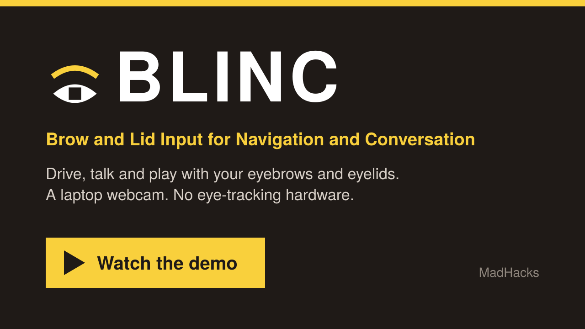
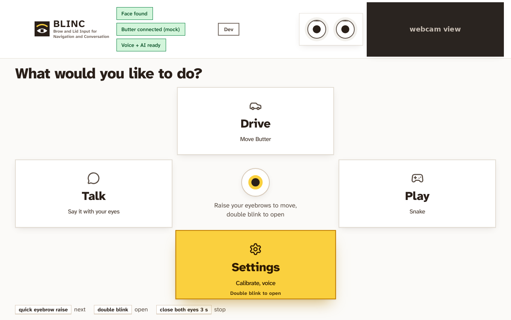
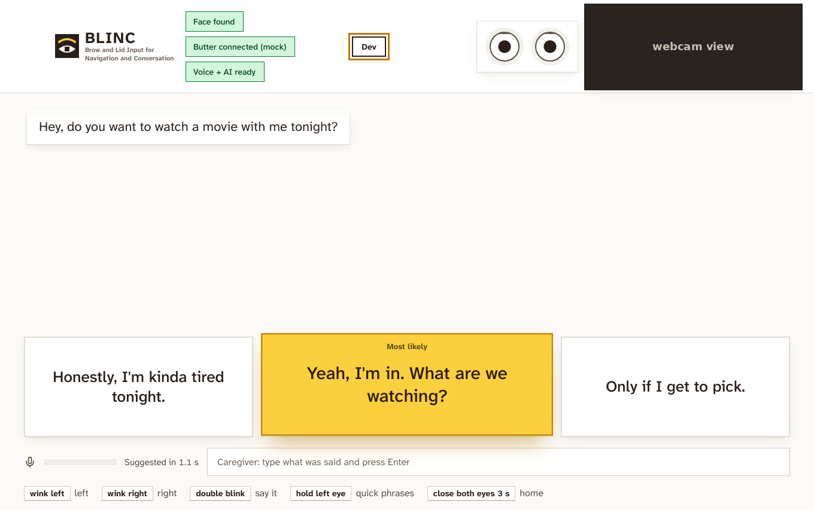
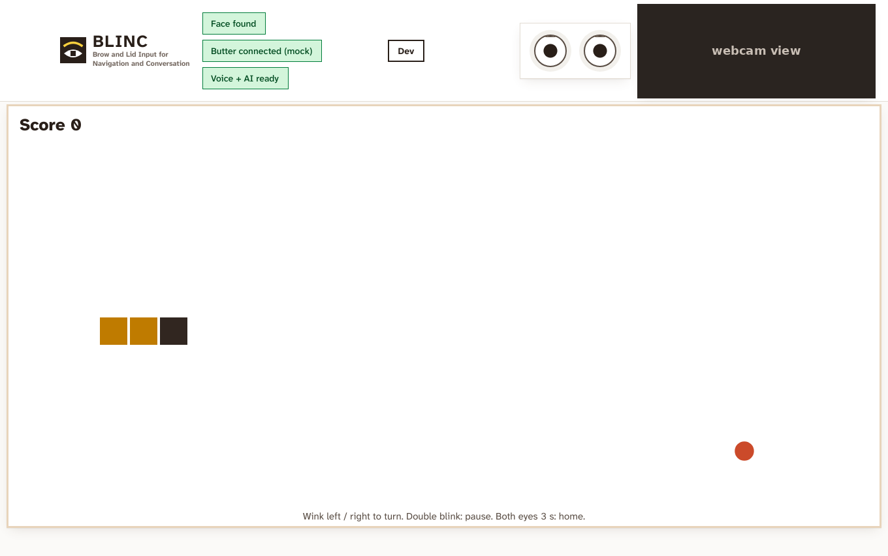
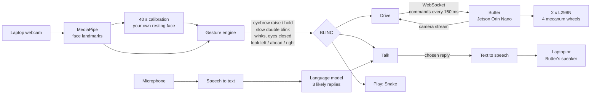
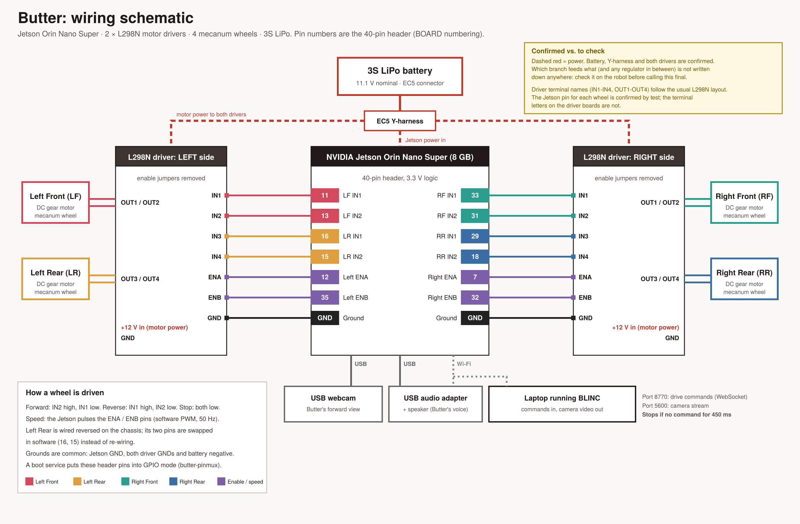

# BLINC

**Brow and Lid Input for Navigation and Conversation**

[](https://www.youtube.com/watch?v=NQsbP_1-HG8)

**[Watch the demo on YouTube](https://www.youtube.com/watch?v=NQsbP_1-HG8)**

BLINC lets a person drive a wheelchair-style robot, hold a spoken conversation, and play a game using only their eyebrows and eyelids. It runs on a laptop with a normal webcam. No eye-tracking hardware.

Built at MadHacks by Anh, Carter and Mason.

## Why we built it

Each of us knows someone living with ALS or another neurodegenerative disease. ALS takes away the most basic kinds of independence: moving, then speaking. Things we take for granted turn into things people dream about getting back.

Tools for this exist, but most of them are out of reach:

- The [CDC's National ALS Registry](https://www.cdc.gov/als/php/abstracts-publications-reports/prevalence-2022-2030.html) estimates close to 33,000 people are living with ALS in the United States alone.
- Purpose-built eye-gaze speech devices are commonly listed at [$11,000 and up](https://undivided.io/resources/eye-gaze-101-3636), and they need dedicated eye-tracking hardware.
- Typing with your eyes is slow. A [2024 paper in Nature Communications](https://pmc.ncbi.nlm.nih.gov/articles/PMC11530652) puts gaze typing at usually under 10 words a minute, against up to 190 for speech.

So we asked one question: can we bring the cost of face-controlled movement and communication down to a laptop webcam, without giving up reliability?

## What it does

| | |
|---|---|
| **Drive** | Look where you want to go and raise your eyebrows. Butter, our robot, moves that way. Relax and it stops. Butter stands in for a power wheelchair, and its camera fills the screen so you see what it sees. |
| **Talk** | BLINC listens to the person speaking to you and offers three likely replies. A quick eyebrow raise moves between them; holding your eyebrows up says the chosen one out loud. |
| **Play** | Snake, steered by winks. It was also our test bench: if the winks were not good enough to play Snake, they were not good enough to drive. |

| Home | Talk | Snake |
|---|---|---|
|  |  |  |

Setup for a new person takes about 40 seconds: follow a circle, close your eyes, raise your eyebrows, wink each side. Everything is measured against that person's own resting face, so normal blinking does nothing.

## How it works



**Reading the face.** [MediaPipe Face Landmarker](https://ai.google.dev/edge/mediapipe/solutions/vision/face_landmarker) gives us face landmarks and blend-shape scores on every frame. For each eye we combine the blink score with the measured gap between the eyelids, then rescale it to that person's own open and closed levels from calibration. Eyebrows and sideways gaze are handled the same way.

**Turning readings into commands.** The gesture engine is plain logic with no machine learning of its own, which makes it testable. A few of the rules:

- A natural blink is ignored. A command blink has to be slower than that person's own blinks.
- A wink is judged by how lopsided the two eyes are, per side, because the other eye half-closes when most people wink.
- Closing both eyes is always "stop" or "back", on every screen.
- One person only. BLINC locks onto the calibrated face and ignores smaller faces behind it, so a crowd cannot take over.

**Talking.** Speech is transcribed with ElevenLabs Scribe, a DeepSeek model writes three short replies in the user's voice, and the chosen one is spoken with ElevenLabs text to speech. The most likely reply sits in the middle, where the selection starts.

**Driving.** The app sends a drive command to Butter every 150 ms over a WebSocket. Butter's server runs on a Jetson Orin Nano and switches two L298N motor drivers.

## Controls

Navigation style and drive style can both be changed in Settings.

| Screen | Gesture | What it does |
|---|---|---|
| Menus | Quick eyebrow raise | Next option |
| Menus | Slow double blink | Open / select |
| Look Drive | Look left, ahead or right, then raise eyebrows | Move that way; relax to stop |
| Look Drive | Slow double blink | Eye control off / on |
| Blink Drive | Slow double blink, twice | Go forward |
| Blink Drive | Double blink, or one long blink | Stop |
| Blink Drive | Close left eye / right eye | Turn right / left (you turn toward your open eye, so you can see where you are going) |
| Talk | Quick eyebrow raise | Next reply |
| Talk | Hold eyebrows 1 s, or slow double blink | Say it |
| Talk | Hold left eye | Quick phrases (Yes, No, I need help, ...) |
| Snake | Wink left / right | Turn |
| Anywhere | Close both eyes 3 s | Stop, then back to the home screen |
| Anywhere (except Look Drive) | Hold eyebrows 4 s | Eye control off / on, so you can blink freely |

Keyboard, for a caregiver or a demo: `C` calibrate, `0` webcam off / on, `B` eye control off / on, `Esc` home, `R` (in Talk) start the conversation over. The **Dev** button in the top bar shows raw face readings live.

## Quick start

Needs macOS, Node.js 20+ and Python 3.

```bash
git clone https://github.com/Kevindo001/blinc_butter.git
cd blinc_butter
cp app/.env.example app/.env     # add your DeepSeek and ElevenLabs keys
./start.sh
```

`start.sh` installs what is missing, looks for Butter (USB-C cable first, then the network address set at the top of the script), and opens the app. No robot? It starts a pretend one so every screen still works:

```bash
./start.sh --mock            # always use the pretend robot
./start.sh --jetson 10.0.0.5 # use a robot at this address
./start.sh --test            # run the automated tests
```

On first launch, allow the camera and microphone, then calibrate.

## What is in this repository

| Folder | What it is |
|---|---|
| [`app/`](app) | The BLINC desktop app (Electron): face tracking, calibration, gesture engine, Drive, Talk, Snake |
| [`butter-drive/`](butter-drive) | The server that runs on Butter: motors, camera stream, speaker |
| [`butter-say/`](butter-say) | A one-page tool: type a line and Butter says it |
| [`docs/`](docs) | Wiring schematic and screenshots |
| `start.sh` | One command to start everything on the laptop |

## Butter, the robot

Butter is built from a Jetson Orin Nano, two L298N motor drivers, four mecanum wheels, a USB camera, a USB speaker and a 3S LiPo battery, on a chassis assembled from spare parts.



Pin map, software details and setup are in [`butter-drive/`](butter-drive).

## Safety

A robot that stands in for a wheelchair has to fail safe. Butter stops when:

- no drive command arrives for 450 ms (lost Wi-Fi, closed laptop, crashed app)
- the app loses the user's face
- the user closes their eyes for half a second while driving
- eye control is switched off
- the webcam is switched off

The motor drivers' enable pins are held low whenever Butter is stopped, so a stuck signal cannot move a wheel. Driving speed is capped low by default.

## Tests

```bash
./start.sh --test
```

- **Gesture engine**: simulated people (glasses, small eyes, weak or one-sided winks, asymmetric faces) blink normally for ten minutes each with zero commands allowed, then perform every gesture hundreds of times.
- **Services**: reply generation, speech to text and text to speech, including live calls when keys are present.
- **Robot server**: the watchdog, speed limits and the command protocol.

There is also an end-to-end run that drives the real app with a recorded face and voice (`app/test/e2e`).

## What is next

- A joystick mode for people without eyebrow control: look up, down, left and right.
- Let each person map their own gestures to actions, since ALS affects everyone differently.
- A way to say something that is not among the suggested replies.
- Trying it with people who have ALS, and on a real power wheelchair controller.

## Team

- **Anh**: software, gesture engine, AI
- **Carter**: hardware, Butter's build and wiring
- **Mason**: testing, demo, control design
